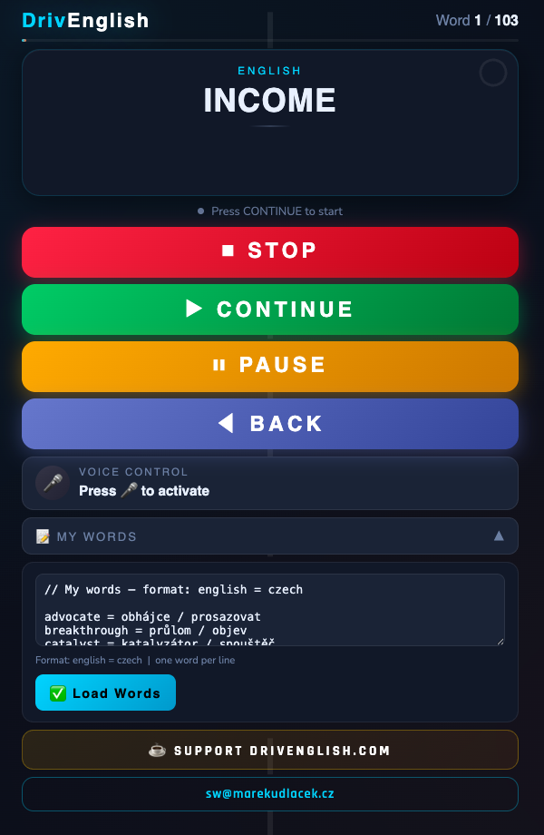

# drivenglish.com

Vocabulary learning app for learning English while driving — plays words aloud (English → Czech) so you can practice hands-free.

🔗 **Live app:** [https://drivenglish.com](https://drivenglish.com)



## Features

- Text-to-speech playback of English words followed by Czech translations
- Voice control (start/stop/pause/next/back) via speech recognition
- Words stored in **Cloudflare D1**, organised into **categories**; each word has an optional **description**
- Pick one or more categories to play (shuffled mix)
- Bulk import: `english = czech | description`, one per line
- Login via **Cloudflare Access** (one-time PIN to e-mail), **30-day free trial**, then a paywall (manual unlock for now)

## Stack

- `public/` — static frontend (single `index.html`, vanilla JS, no build step)
- `src/worker.js` — Cloudflare Worker serving `/api/*`, verifies the Access JWT, talks to D1
- `migrations/` — D1 schema (`users`, `categories`, `words`)

## Local development

```bash
cp .dev.vars.example .dev.vars   # sets DEV_USER_EMAIL, bypasses Access on localhost only
npm run dev                      # applies D1 migrations locally + wrangler dev
```

Open http://localhost:8787.

## Deployment (Cloudflare Workers Builds, from `main`)

Every push to `main` builds and deploys automatically. The deploy command applies pending D1 migrations first (`wrangler` tracks applied ones in the `d1_migrations` table, so re-running is safe), then deploys the Worker.

One-time setup:

1. **Access first** — Zero Trust → Access → Applications → *Add self-hosted app* for `drivenglish.com` (path `/*`), policy **Allow / Everyone**, login method **One-time PIN**. Copy the **Application Audience (AUD) tag** into `ACCESS_AUD` in `wrangler.toml` and push. Without it every API call returns 401.
2. Workers & Pages → Create → **Import a repository** → `marekudlacek/drivenglish.com`
   - Production branch: `main`
   - Build command: *(empty)*
   - **Deploy command: `npm run deploy`**
3. Make sure the Workers Builds API token has **D1 → Edit** permission (Settings → Builds → API token); otherwise the migration step fails.
4. Attach the custom domain `drivenglish.com` to the Worker (Settings → Domains & Routes) and detach it from the old Pages project.

D1 database `drivenglish` and team domain are already set in `wrangler.toml`. Adding a schema change = new file `migrations/000N_*.sql`; it is applied on the next deploy.

> Free Zero Trust plan covers up to 50 users.

## Trial & unlocking a paid user

Trial length is `TRIAL_DAYS` in `wrangler.toml` (default 30). After it ends the API returns `402` and the app shows the paywall. To unlock a user:

```bash
wrangler d1 execute drivenglish --remote --command "UPDATE users SET paid_until='2027-12-31' WHERE email='user@example.com'"
```

List users and their status:

```bash
wrangler d1 execute drivenglish --remote --command "SELECT email, first_seen, paid_until FROM users ORDER BY first_seen DESC"
```
